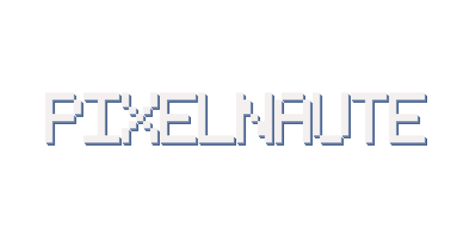

<div align="center">


# Pixelnaute

### Un navigateur web expérimental pour New Nintendo 3DS

Un moteur HTML/CSS natif, directement sur la console — sans navigateur distant ni proxy de rendu.

<p>
  <a href="https://github.com/dodosiiii/Pixelnaute/releases"></a>
  <a href="https://github.com/dodosiiii/Pixelnaute/actions/workflows/pc-tests.yml"></a>
  <a href="https://github.com/dodosiiii/Pixelnaute/actions/workflows/release.yml"></a>
</p>



**Version : 0.7.0** · [Télécharger une version](https://github.com/dodosiiii/Pixelnaute/releases) · [Signaler un problème](https://github.com/dodosiiii/Pixelnaute/issues)

</div>

> [!WARNING]
> Pixelnaute est un projet expérimental en développement, destiné aux
> **New Nintendo 3DS**, **New Nintendo 3DS XL** et **New Nintendo 2DS XL**.
> Les modèles 3DS/2DS d’origine ne sont pas pris en charge. Les sites complexes,
> les applications web modernes et certaines pages protégées peuvent ne pas
> fonctionner.

## Sommaire

- [Installation](#installation)
- [Fonctionnalités](#fonctionnalités)
- [Commandes](#commandes)
- [Compiler depuis les sources](#compiler-depuis-les-sources)
- [Tests](#tests)
- [Limites et mémoire](#limites-et-mémoire)
- [Structure du projet](#structure-du-projet)
- [Contribuer](#contribuer)
- [Licence et attribution](#licence-et-attribution)

## Installation

### Depuis une release

1. Téléchargez **`N3DSWeb.3dsx`** depuis les [releases GitHub](https://github.com/dodosiiii/Pixelnaute/releases).
2. Copiez-le sur la carte SD, par exemple dans `sd:/3ds/Pixelnaute/`.
3. Lancez-le depuis le **Homebrew Launcher**.

Une version **CIA** est également proposée dans les releases pour les
New 3DS compatibles. Installez-la avec un gestionnaire de titres homebrew.
Le CIA utilise une bannière animée et prend en charge la mise à jour intégrée ;
cette fonction n’est pas disponible dans la version `.3dsx`.

### Installer le CIA avec FBI

Sur la console, connectez-vous au Wi-Fi, ouvrez FBI et choisissez
**Remote Install > Scan QR Code**. Scannez ce code pour télécharger et installer
le CIA de la release **v0.7** directement depuis GitHub :

<p align="center">
  <a href="https://github.com/dodosiiii/Pixelnaute/releases/download/v0.7/N3DSWeb.cia">
    
  </a>
</p>

## Fonctionnalités

### Navigation

- Navigation HTTP/HTTPS, redirections, cookies de session, historique,
  favoris et onglets.
- Page interne **Test affichage** depuis l’accueil et le menu : éléments de
  rendu, formulaire et raccourcis de vérification pour Wikipédia, Google et
  Reddit.
- DuckDuckGo Lite par défaut, avec Wikipedia et Mojeek comme moteurs alternatifs.
- Mode lecteur, recherche dans la page actuellement chargée, mini-carte avec
  repères de liens et d’ancres, et QR code pour partager une URL (jusqu’à
  106 octets après encodage).
- Flux RSS 2.0 et Atom affichés sous forme compacte.
- Formulaires GET et POST `application/x-www-form-urlencoded`.
- Téléchargement explicite de fichiers vers la carte SD, avec reprise si le
  serveur accepte les requêtes `Range` et une limite de 32 Mio.
- Écran **Menu > Téléchargements** : les fichiers enregistrés par le navigateur
  apparaissent dans `sdmc:/N3DSWeb/downloads`. Les PDF copiés manuellement dans
  `sdmc:/N3DSWeb/pdfs` apparaissent aussi dans cette même liste, sans devoir
  les copier dans les deux dossiers. Les fichiers affichent extension, date
  et taille ; touchez un PDF ou sélectionnez-le avec `A` pour l’ouvrir.
  Le lecteur maison affiche le texte décodé des PDF et permet de passer d’une
  page à l’autre. Sur un PDF ouvert, maintenez `ZL + ZR` pour parcourir les
  niveaux de zoom 100 %, 125 %, 150 %, 200 %, 300 %, puis revenir à 100 %.
  Le zoom relance le rendu du texte à la taille choisie, au lieu d’agrandir une
  image basse résolution. En zoomant, faites glisser le doigt à gauche/droite
  sur la zone de contenu pour déplacer la page ; le Circle Pad et la croix
  directionnelle déplacent aussi horizontalement le PDF agrandi.
  Les couleurs du texte, tailles, styles gras/italique et polices Courier
  monospaces extraits du PDF sont conservés. Certains grands espacements de
  texte sont convertis en colonnes de tableau simples.
  Ce lecteur texte ne reproduit pas encore les images, dessins, couleurs de
  fond, types de polices incorporées, cellules fusionnées ou positions exactes
  de la page ; les PDF chiffrés, scannés et certaines polices sans table Unicode
  restent incompatibles. Les autres formats sont listés
  mais ne sont pas encore ouvrables depuis l’application.
- Cache SD pour les pages, feuilles de style, scripts et images, avec
  revalidation HTTP et gestion depuis les réglages.

### Rendu et scripts

- Analyse HTML tolérante avec les entités nommées HTML5, les noms de balises
  personnalisés, les valeurs d’attributs non citées contenant des `/` et la
  conservation de la première valeur d’un attribut dupliqué, les fermetures
  implicites courantes (paragraphes, titres, listes et tableaux), les
  corrections simples de contenu de tableau, la fermeture des modes texte
  même si la balise fermante contient des attributs, les modes texte de
  `title`/`textarea`, le mode texte jusqu’à la fin du document de `plaintext`
  et l’affichage du contenu de secours pour `canvas`, `audio` et `video`. Le
  DOM peut être modifié par les scripts.
- Ce parseur ne reproduit pas encore toutes les règles de construction d’arbre
  HTML5 : les réparations de balisage profondément mal formé restent partielles,
  et SVG, iframes, les médias eux-mêmes et les templates ne sont pas rendus.
- Moteur CSS partiel : cascade, sélecteurs courants, pseudo-classes enfants,
  sélecteurs frères et d’attributs usuels, variables CSS, italique,
  transformation du texte, espacement des lettres en `px` et `em`, modes `white-space`
  courants dont `pre-wrap`,
  requêtes média simples avec alternatives séparées par des virgules et
  conditions `@supports` prudentes pour les propriétés reconnues,
  dimensions en pourcentage, alignement du texte justifié, découpage `overflow`
  partiel, sélection accélérée par index de balise/classe/identifiant, sélecteur
  universel `*`, couleurs, dégradés,
  images avec `object-fit: fill|contain|cover` et `object-position` simple,
  bordures configurables par côté, `inline-block` simple, `float: right`,
  `position: relative` et
  positionnement `absolute`/`fixed` partiel, mise en page de tableaux CSS
  simple (`table`, `table-row`, `table-cell`), Flexbox partiel (dont
  `row-reverse` et `column-reverse`) et Grid partiel.
- Moteur JavaScript QuickJS expérimental, avec prise en charge partielle du DOM,
  des événements, des temporisateurs, du stockage, de `fetch` et de
  XMLHttpRequest. Les requêtes `fetch`/XHR sont limitées à la même origine :
  CORS n’est pas encore implémenté, et les réponses après redirection vers
  une autre origine sont bloquées. Les réponses `fetch`/XHR sont limitées à
  256 Kio ; les réponses plus grandes échouent plutôt que d’être tronquées.
- Chargement des images désactivé par défaut. Quand il est activé, les images
  proches de l’écran sont traitées en priorité et adaptées au budget mémoire.
- Mode sombre des pages et taille du texte réglable.

### Interface et outils développeur

- Interface disponible en anglais, français, italien et espagnol.
- Réglages de navigation, de moteur de recherche, de certificats TLS et de
  chargement des images.
- Les outils développeur sont masqués du menu normal : maintenez `L + R` et
  appuyez sur `SELECT` pour les ouvrir ou les fermer. Ils affichent des
  informations sur la page, le DOM, les ressources, le réseau et la mémoire.
- Depuis cet écran, `A` ouvre la suite locale de test HTML/CSS ; `L` et `R`
  choisissent un site réel (Wikipédia, GitHub, Hacker News ou Google), et `X`
  l’ouvre. Le test des sites est manuel, car leur disponibilité et leur rendu
  dépendent de leur serveur et de l’accès réseau.

## Commandes

| Action | Commande |
| --- | --- |
| Ouvrir le menu | `START` |
| Parcourir les pages | Circle Pad |
| Déplacer le pointeur (New 3DS) | C-Stick |
| Activer un lien ou une option | `A` ou toucher l’écran |
| Utiliser la barre d’adresse | Toucher l’écran inférieur |
| Valider une adresse | `X` |
| Faire défiler une page | Circle Pad ou glisser sur l’écran |
| Ouvrir/fermer les outils développeur | Maintenir `L + R`, puis appuyer sur `SELECT` |

Dans la barre d’adresse, pendant la saisie, le Circle Pad choisit une touche,
`A` l’insère et le C-Stick déplace le curseur. Dans le menu, déplacez le
contour de sélection avec le Circle Pad et validez avec `A`.

## Compiler depuis les sources

### Windows avec devkitPro

Installez devkitPro/devkitARM et les bibliothèques nécessaires : libctru,
Citro2D, Citro3D, libcurl, mbedTLS et zlib. Depuis la racine du dépôt :

```powershell
powershell -ExecutionPolicy Bypass -File .\build.ps1
```

Le script produit `N3DSWeb.3dsx` et `N3DSWeb.elf`. Il utilise les chemins
devkitPro définis dans `build.ps1` ; adaptez-les si votre installation est
ailleurs.

Pour construire également le CIA, installez `bannertool` et `makerom`, puis
lancez :

```powershell
powershell -ExecutionPolicy Bypass -File .\build.ps1 -BuildCIA
```

### Linux ou environnement devkitPro déjà configuré

Avec `make` et `DEVKITARM` configurés :

```sh
make
make cia
```

Le CIA utilise l’identifiant de titre personnalisé `000400000FF6A600` et le
mode mémoire étendu de 124 Mio. Il est réservé aux modèles New 3DS.

### Bannière animée

La bannière standard du CIA affiche le mot **PIXELNAUTE** en 3D, en rotation,
sans panneau de fond. Le modèle CGFX reste sous la limite de 512 Kio et le
script de build vérifie cette limite. Pour régénérer le modèle et son aperçu,
sous Windows avec Python, Git et les dépendances indiquées dans
`tools/banner/requirements.txt`, lancez :

```powershell
powershell -ExecutionPolicy Bypass -File .\tools\banner\build-banner.ps1
```

Le build CIA utilise `assets/pixelnaute-banner.cgfx` lorsqu’il est disponible.
La bannière animée doit encore être vérifiée sur une vraie console avant toute
publication : un build réussi ne remplace pas ce test.

## Mises à jour intégrées

Dans la version CIA, **Réglages > Installer mise à jour CIA** recherche une
release stable plus récente. Après confirmation, Pixelnaute télécharge le CIA,
vérifie son empreinte SHA-256, puis demande au système de l’installer et de
redémarrer le titre. La version `.3dsx` ne dispose pas de cette fonction.

## Tests

### Tests PC sous Windows

Avec Visual Studio et `cl.exe`, lancez :

```powershell
powershell -ExecutionPolicy Bypass -File .\tests\pc\run.ps1
```

La génération de l’image de contrôle est facultative et nécessite Python et
Pillow.

### Tests PC sous Linux

```sh
bash tests/pc/run-linux.sh
```

Les tests couvrent les résolveurs de recherche, le parseur HTML/CSS, le lecteur
PDF et certaines fonctions de rendu. GitHub Actions les exécute également sur
chaque push et pull request. Ils ne remplacent pas les essais sur console :
Wi-Fi, téléchargements, lecture PDF, installation CIA et rendu sur l’écran 3DS
doivent être vérifiés sur le matériel.

## Limites et mémoire

Pixelnaute n’est pas un navigateur de bureau complet. Les pages sont récupérées
directement par la console ; aucun proxy distant n’est requis. Les ressources
réseau sont traitées séquentiellement, ce qui peut ralentir les pages complexes.

Les limites actuelles sont volontairement adaptées à la mémoire de la console :

| Ressource | Limite actuelle |
| --- | --- |
| Téléchargement HTML | 4 Mio maximum, ajusté si la mémoire disponible est insuffisante |
| Nœuds DOM | 16 384 |
| Règles CSS | 1 536 |
| Feuilles de style | 128 Kio |
| Texte DOM | Arène de 4 Mio |
| Contenu de page | Jusqu’à 5 segments, avec rendu progressif |
| Onglets | 2 pendant la phase de test mémoire |
| Mémoire du runtime JavaScript | 4 Mio par page |
| Cache des segments sur carte SD | 1 Gio ; entrées de plus d’une semaine supprimées |

CSS Grid et Flexbox sont partiels. Les transformations, animations, images de
fond, positionnements autres que `relative` et plusieurs sélecteurs ne sont pas pris en
charge ou peuvent différer des navigateurs modernes. Les API JavaScript sont
également partielles ; les SPA, les défis anti-bot et les sites qui exigent un
navigateur officiellement pris en charge peuvent échouer.

`position: relative` avec des décalages fixes `top`, `right`, `bottom` et
`left` déplace le rendu sans changer la place gardée dans le flux. Les
décalages horizontaux en pourcentage utilisent la largeur du bloc courant ;
les décalages verticaux en pourcentage ne fonctionnent que si le parent a une
hauteur explicite. `absolute`, `fixed` et `sticky` ne sont pas pris en charge.

`overflow: hidden|clip` découpe le rendu ; le défilement et les barres
`overflow: auto|scroll` ne sont pas simulés. Le découpage vertical n’est
appliqué qu’aux blocs ayant une hauteur explicite. Les hauteurs en pourcentage
ne sont calculées que si le parent définit une hauteur explicite.

Les images sont désactivées par défaut. Leur décodage peut être ignoré si la
mémoire disponible est insuffisante. Le navigateur limite également la durée
d’exécution des scripts afin de préserver la réactivité. Les formulaires
multiparties, comme l’envoi de fichiers, ne sont pas pris en charge.

Le lecteur PDF expérimental accepte des fichiers de 8 Mio maximum et 128 pages
au plus. Il extrait le texte des flux non compressés ou compressés en Flate,
décode les tables `ToUnicode` courantes, les plages CMap, y compris celles
avec des tableaux de caractères, les différences d’encodage de polices simples
et les encodages Windows-1252 et MacRoman. Les tailles, couleurs de texte,
styles gras/italique et polices Courier monospaces sont appliqués au texte
extrait. Les espacements de texte importants peuvent reconstruire des
tableaux simples. Les filtres autres que Flate, les PDF chiffrés, les polices
Type0 sans table Unicode, les images, les fonds colorés et la mise en page
graphique précise ne sont pas encore pris en charge.

## Structure du projet

| Dossier | Contenu |
| --- | --- |
| `source/browser/` | Navigation, onglets et chargement des pages |
| `source/network/` | Transport HTTP/HTTPS |
| `source/html/` et `source/css/` | Analyse HTML, DOM et styles |
| `source/render/` | Mise en page et rendu |
| `source/search/` | Moteurs de recherche |
| `source/ui/` et `source/input/` | Interface et commandes |
| `source/settings/` et `source/storage/` | Réglages et données persistantes |
| `source/updater/` | Recherche et installation des mises à jour |
| `tests/` | Tests PC et outils de diagnostic |
| `tools/banner/` | Génération de la bannière 3D |

## Contribuer

Les rapports de bogues et les contributions sont les bienvenus. Pour aider à
reproduire un problème, indiquez :

1. Le modèle de console et le mode utilisé (`.3dsx` ou CIA).
2. L’adresse du site et les étapes pour reproduire le problème.
3. Si possible, les journaux `boot.txt` et le dossier `diag` de
   `sdmc:/N3DSWeb/`. Vérifiez qu’ils ne contiennent aucune information
   personnelle avant de les partager.

## Licence et attribution

Le code et les éléments originaux de Pixelnaute sont distribués sous la
[licence avec attribution Pixelnaute](./LICENSE). Toute redistribution,
y compris d’une version modifiée ou binaire, doit inclure la licence et
conserver le crédit à **@dodosiiii**. Les composants tiers restent soumis à
leurs propres avis de copyright et licences.
